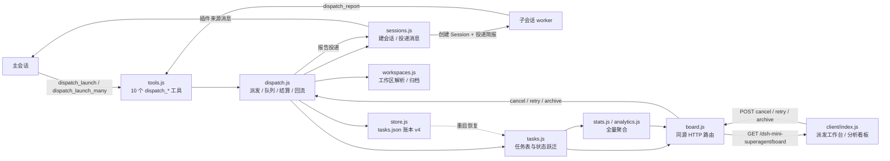

# dsh-mini-superagent

**DeepSeek Harness（DSH）的任务派发与编排插件**：主会话派活，子会话干活，报告自己回来。

[](https://github.com/wychmod/dsh-mini-superagent/actions/workflows/ci.yml)
[](dsh-mini-superagent/LICENSE)
[](dsh-mini-superagent/package.json)
[](https://www.npmjs.com/package/dsh-mini-superagent)
[](dsh-mini-superagent/package.json)

**10** 个工具 · **629** 个单元测试 · **450** 项客户端渲染检查 · **0** 运行时依赖 · **MIT**

> **In English**: `dsh-mini-superagent` is a task dispatch and orchestration plugin for DeepSeek Harness (DSH): the main session hands a self-contained brief to an independent background sub-session, and the report flows back automatically. Pure ESM, zero runtime dependencies, 10 tools, a web board and an auditable JSON ledger. Docs live under `dsh-mini-superagent/docs/` and are not shipped in the npm package.

> **版本**：当前工作区版本 0.9.1；已发布版本以 [`CHANGELOG.md`](dsh-mini-superagent/CHANGELOG.md) 为准。0.9.1 已发布到 npm，并已推送到 `main` 且打了 `v0.9.1` tag；安装方式见「快速开始」。

## 它解决什么问题

- **把活派出去，不把 step 占住**：`dispatch_launch` 登记任务、投递简报后立即返回；子会话在自己的 Session 里跑完整回合，报告作为插件来源的消息回流。主会话空闲时被唤醒，忙碌时并入下一个 step。
- **一次派一批，并发可控**：`dispatch_launch_many` 一次派 1–16 条互相独立的任务；全局最多 `maxWorkers=6` 个同时 `running`，超出的进 `queued`，每个结算点自动补位。
- **做完的上下文还能接着用**：worker 是有历史的 Session。可以 `dispatch_message` 追问、纠偏，也可以用 `continue_task_id` 续派同一任务，或用 `handoff_from` 新建任务并沿用来源子会话。
- **过程看得见**：侧边栏「派发工作台」展示并发、排队、批次进度（`2/5`）、依赖等待、失败原因与重试健康；另有一个分析看板看趋势与完成率。
- **出了事查得到**：任务与报告落在 `tasks.json`（v4），重启恢复、未结算标 `interrupted`、退休任务留痕，`dispatch_inspect` 能翻到最后一次输出。

## 它不是什么

| 它不是 | 原因 |
| --- | --- |
| 同步 subagent | 同步调用要等结果；这里派发只登记 + 投递就返回 |
| 任务队列服务 | 没有持久队列、没有重试策略；重启后未结算任务标 `interrupted`，由你决定是否重派 |
| 权限系统 | 不裁剪 worker 工具集；需要收紧时给子会话指定 `agent_preset` |
| 多机调度 | 状态是一个本地 JSON 文件，单写，不跨进程协调 |

## 核心能力

| 能力 | 说明 | 状态 |
| --- | --- | --- |
| 任务派发 | `dispatch_launch` / `dispatch_launch_many` / `dispatch_wait`；派发立即返回，批量 1–16 条 | 已实现 |
| 会话复用 | `continue_task_id` 续派同一任务；`handoff_from` 新建任务、沿用来源子会话，`handoff_reason` 记录原因 | 已实现 |
| 计划透出 | worker 在 `dispatch_report` 里带 `plan`，看板任务行显示 `2/5`，抽屉显示当前步骤（上限 12 步 × 120 字） | 已实现 |
| 批次依赖 | `depends_on` / `depends_on_index`；前置未结算时保持 `queued`，不占并发位；前置失败或取消会连带取消 | 已实现 |
| 看板 | 四视图（全部 / 进行中 / 需要处理 / 已归档）+ 独立「已退休」视图 + 分析看板；另有 `GET /board`、`/board/retired`、`/board/stats`、`/board/analytics` | Web 形态 |
| 记忆治理 | 1.5 秒通知合并窗口（上限 2 秒）、事实与投影分离、账本 1000 条 / 90 天封顶、退休留痕（13 字段摘要，不保留报告正文） | 已实现 |
| 健康度 | `retry_health`（重试次数 / 起始时间 / 最后错误）与 `GET /board/stats` 全量聚合（不受 200 条快照上限影响） | 已实现 |
| 质量闸门 | `npm run check:dev`（原 `check`）= 语法检查 + 629 单测 + 450 客户端离线渲染检查；GitHub Actions 跑同一条链 | 已实现 |

> 看板路由前缀均为 `/dsh-mini-superagent`。

## 架构

主会话只接触 `tools.js`；派发逻辑在 `dispatch.js`，纯状态与队列在 `tasks.js`，落盘在 `store.js`，所有宿主 API 收在 `sessions.js`。看板走同源 HTTP（`board.js`），浏览器侧不打包、不编译。



一句话读图：`dispatch_launch` 进来，`dispatch.js` 登记任务（`tasks.js`）并落盘（`store.js`），由 `sessions.js` 建会话、投简报；worker 用 `dispatch_report` 回到 `tools.js`，`dispatch.js` 再把报告投回主会话。看板从任务表与聚合模块取数。

## 快速开始

要求：DSH `>=0.2.1-rc.2`；Node `^22.19.0 || >=24.0.0`；无运行时依赖、无构建步骤。

### 1. 安装

npm 已发布 `0.9.1`，在 DSH 里调用：

```text
plugin_manager(action="install_bundle", target="dsh-mini-superagent@0.9.1")
```

也可以从仓库安装：先 `git clone https://github.com/wychmod/dsh-mini-superagent.git`，再把 `target` 换成本地路径 `<仓库路径>/dsh-mini-superagent`。

装完确认 **10 个 `dispatch_*` 工具**已注册，并刷新一次 GUI 页面——侧边栏图标与输入框控件要等页面刷新后才加载。

### 2. 验证

```text
dispatch_list()
→ {"version":"0.9.1","total":0,"running":0,"max_workers":6,"tasks":[]}
```

`version` 与 `src/constants.js` 的 `VERSION` 一致；`max_workers` 等于配置里的 `maxWorkers`（默认 6）。

### 3. 一次派发

```text
dispatch_launch({
  title: "重构 auth 模块",
  brief: "目标：把 auth 从单文件拆成独立模块。\n约束：不改公开 API。\n验收：npm test 全绿。\n已知事实：入口在 src/auth.js。"
})
→ 返回 task_id；有空位立即 running，并发位满则 queued。
```

要落到某个项目就加 `workspace: "<工作区 id / 绝对路径 / 标题>"`；不指定时先看输入框的「派发目标」，没有目标才沿用调用者目录。子会话看不到主会话的历史，**brief 必须自包含**：目标、约束、验收、已知事实。

### 4. 看板

刷新 GUI，点侧边栏的「派发工作台」：并发 / 排队、批次 `2/5`、失败原因、取消 / 重试 / 归档都在一页。不想装宿主也可以直接打开 [`preview/board-preview.html`](dsh-mini-superagent/preview/board-preview.html)——真实面板组件 + 假数据的离线预览（需联网取 React）。

### 升级注意

- 装完或升级后刷新一次 GUI 页面。
- `workerWorkspace` 自 0.8.1 起**只决定无目标时的兜底**（`day` = 当天【派发】工作区，`cwd` = 任务目录）；旧值 `target` 按 `day` 处理，不报错。
- 不要和旧插件 `dsh-dispatch` 同时安装：两者有 8 个同名工具，同一全局层重复注册会直接抛错。

## 为什么用这个，而不是自己写脚本

| 维度 | 这个插件 | 自己写脚本 |
| --- | --- | --- |
| 运行形态 | 纯 ESM、零运行时依赖、无构建；`install_bundle` 装上即用 | 自己接 Session / Agent / 收件箱 API，处理并发与排队 |
| 账本 | `tasks.json` v4 是派发事实的唯一权威；报告、重试、退休都有记录，`dispatch_inspect` 可查 | 通常只有 stdout 或临时文件，重启即丢 |
| 失败恢复 | 重启恢复账本；未启动的排队任务重新入队，运行中的标 `interrupted`；瞬时故障按退避续跑 | 进程挂了就得从头来 |
| 可观测 | 侧边栏看板（四视图 + 分析看板），2 秒轮询，不用翻日志 | 自己写 UI，或 grep 日志 |

## 文档

| 文档 | 内容 |
| --- | --- |
| [`dsh-mini-superagent/README.md`](dsh-mini-superagent/README.md) | 安装、10 个工具、典型用法、状态流转、看板、工作区、输入框控件、配置、限制 |
| [`docs/architecture.md`](dsh-mini-superagent/docs/architecture.md) | 模块职责、数据流、设计决策、失败与降级路径 |
| [`docs/board.md`](dsh-mini-superagent/docs/board.md) | 派发工作台与分析看板：面板结构、HTTP 路由、指标口径、鉴权 |
| [`docs/tools.md`](dsh-mini-superagent/docs/tools.md) | 10 个工具的参数、返回值、错误码、何时用 / 何时别用 |
| [`docs/workspaces.md`](dsh-mini-superagent/docs/workspaces.md) | 工作区模型、目录约定、解析规则、自动归档、限制与排障 |
| [`docs/composer.md`](dsh-mini-superagent/docs/composer.md) | 输入框派发目标选择器、`@` 工作区、chip 契约与降级 |
| [`docs/troubleshooting.md`](dsh-mini-superagent/docs/troubleshooting.md) | 排障表、日志前缀、恢复动作 |
| [`docs/api-contracts.md`](dsh-mini-superagent/docs/api-contracts.md) | DSH 宿主 API 取证：消息构造、Agent、事件、会话控制器、工具作用域 |

> **npm 包里不含 `docs/`**：包的 `files` 白名单只有 `src/`、`client/`、`cordis.patch.yml`、`locale/`、`icon.svg`、`README.md`、`CHANGELOG.md`、`LICENSE` 与 `package.json`。从 npm 安装后点 `docs/` 链接会 404，请到仓库查看。

## 仓库结构

| 路径 | 内容 |
| --- | --- |
| [`dsh-mini-superagent/`](dsh-mini-superagent/) | 插件包本体：`src/` 源码、`client/` 浏览器面板、`test/`、`docs/`、`locale/` |
| [`scripts/`](scripts/) | 仓库级冒烟脚本：`client-smoke.mjs`、`http-smoke.mjs`、`board-preview.mjs` |
| [`.github/workflows/ci.yml`](.github/workflows/ci.yml) | CI：语法检查 + 单测 + 客户端离线渲染检查 |
| [`plans/`](plans/) | 产品规划与 PRD，含已知限制与取证；入口见 [`plans/README.md`](plans/README.md) |
| [`notes/`](notes/) | 本机 DSH 环境的排查记录，**不是插件文档** |
| [`reference/`](reference/README.md) | DSH 上游原型的只读指针；目录内容被 `.gitignore` 排除 |

## 已知限制（摘要）

- **看板只支持 Web 形态**：headless 没有 `webServer` 时不注册路由，派发与工具照常工作。
- **排队只在内存**：重启后未启动的排队任务会重新入队，已经在跑的标 `interrupted`；队列顺序靠登记顺序重建。
- **状态文件是单写的**：多个 Harness 实例共用同一个 `DSH_HOME` 时可能互相覆盖；用 `stateDir` 隔离。
- **看板快照最多 200 条**：计数按全量算，列表只截前 200；没有分页与历史归档（`/board/stats` 与 `/board/analytics` 读全量账本）。
- **`maxWorkers` 是软上限**：`dispatch_message` 唤醒已结算的 worker 会直接置 `running`，可能短暂超过上限。
- **worker 工具面不收窄**：worker 能看到全局工具；要更严的工具面，用 `agent_preset`。路由模式只在「必派发」会话收窄 `write` / `edit`。
- **读回执依赖宿主事件**：收不到 `session/event` 时「已投递未读」会一直显示，只影响展示，不影响投递。
- **界面未做真机视觉验收**：布局、portal 翻转、主题对比度、`@` 与官方 `@reference` 混排、chip 恢复等仍以离线断言与人工目视为准。
- **指标有窗口**：成功率 / 中位耗时 / 并行节省只算最近 7 天 / 200 条内的已结算任务，且排除已归档与已退休。
- **`retry_health` 与 `retiredDropped` 不落盘**，重启归零，不是累计值。

## Roadmap

### 已发布（0.9.1，npm + GitHub Release）

- 非阻塞派发、批量派发、并发队列、报告自动回流、自动归档、工作区。
- 看板四视图 + 独立「已退休」视图 + 分析看板；`retry_health` 与 `/board/stats`。
- 续派（`continue_task_id`）、交接（`handoff_from`）、计划透出（`plan`）、批次依赖（`depends_on`）。
- 记忆治理 P0/P1：通知合并窗口、事实与投影分离、账本封顶与退休留痕。
- 质量闸门：`npm run check:dev`（629 单测 / 450 客户端检查）与 GitHub Actions CI。
- 发布面：`dsh-mini-superagent@0.9.1` 已上 npm（`latest`），并打 `v0.9.1` tag、发 GitHub Release。

### 未做（真实缺口）

- **真机视觉验收**：控件对齐、弹层翻转与边缘夹取、深浅色对比度、chip 刷新恢复等未在真实浏览器逐项验证。
- **token / 成本计量**：需要宿主提供 usage 事件；当前账本没有费用字段，不做估算。
- **队列持久化**：排队顺序只在内存，没有落盘队列。
- **多机调度**：本地单写 JSON，不做跨进程协调。
- **看板分页 / 历史归档**：快照列表上限 200 条。

## Contributing

欢迎 issue 和 PR。改动前先读 [`docs/architecture.md`](dsh-mini-superagent/docs/architecture.md) 与对应 PRD；提交前在包目录跑完整的质量闸门：

```bash
cd dsh-mini-superagent
npm run check:dev
```

约束：不引入运行时依赖、不加构建步骤、不跳过失败断言；文档里的数字（工具数、版本号、测试数）必须与代码 / `CHANGELOG.md` 同源。新增或修改面板行为时，同时补 `test/` 与 `scripts/client-smoke.mjs` 的断言。

## License

MIT，见 [`dsh-mini-superagent/LICENSE`](dsh-mini-superagent/LICENSE)。
